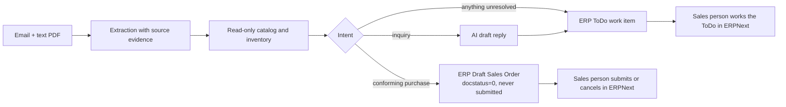

# Langorder-ai

A bounded B2B email-to-ERP workflow in TypeScript: turn a customer email into an ERP document a sales person reviews **inside ERPNext**, with source evidence, deterministic validation, and no model write access. Stack: LangGraph, LangChain, LangSmith, SQLite checkpoints, ERPNext REST.

All names, mail, and records are fictional. Every live model path uses only `gemini-2.5-flash-lite`; deterministic tests make no model calls.

**Run it:** [docs/run-erp.md](docs/run-erp.md) — start the local ERPNext and drive the whole flow. Every command, in order, with what it does and why: [docs/commands.md](docs/commands.md).

## Flow



A second, native path handles mail that lands in the ERP's own mailbox: an `Email Account` pulls it over IMAP, Frappe creates a `Communication` (deduplicated by Message-ID) plus a `Lead` for an unknown sender, and `npm run inquiry:sync` turns each one into an `Inquiry` carrying the AI draft reply. The review happens through an ERPNext workflow.

## Quick start

Requirements: Node.js 22.18 or newer.

```powershell
npm ci
npm run check          # tsc --noEmit
npm test
```

`npm test` runs 61 deterministic tests and `npm run check` is clean; CI runs both plus the failure lab. There is no application UI — mail arrives through the ERP and the record a human works is an `Inquiry` in ERPNext.

## Human control is the ERP's, not ours

There is deliberately no approval screen in this repository. Authority sits where the ERP already enforces it:

- a purchase mail that passes deterministic conformance becomes a **Draft Sales Order**; only a human with submit permission can turn it into a commitment;
- anything the ERP cannot represent (unknown customer, unresolved item, missing address) becomes a **ToDo** — never a half-invented order;
- an `Inquiry` moves `Pending Review → Qualified / Rejected` through an ERPNext workflow, recording `modified_by` and a timestamp.

There is nothing to "roll back" here: the only order write is a never-submitted draft, and the only reply write is a work item that is never sent. The model gets no ERP credentials; the integration user is forbidden `DELETE`.

## Reliability

`npm run failure-lab` runs four scenarios against the in-process mock ERP — no Docker, no ERPNext, no model calls — and prints a pass/fail line with the evidence:

- **duplicate with changed content** — a re-delivered PO is refused (`DUPLICATE_CHANGED_OR_NOT_DRAFT`), never overwritten;
- **ERP write times out after commit** — concurrent calls reconcile to one order by integration key;
- **ERP unavailable** — a failed read leaves a retryable checkpoint instead of losing the message;
- **ambiguous item stays blocked** — an unresolved item never reaches the ERP.

## Architecture

- `src/input.ts` — email/PDF text with exact source evidence (subject and sender are separate sources).
- `src/model.ts` — the single fixed Gemini entry point; no ERP write permission.
- `src/domain.ts` — deterministic validation, conformance gates, date/quantity normalisation.
- `src/workflow.ts` — routing, tool calls, checkpoints, and the ERP handoff decisions.
- `src/erp.ts` — ERPNext REST boundary: reads, one draft write, work items, review-state read-back.
- `src/review-sync.ts` — resumes a paused workflow from the ERP's own `docstatus`; it cannot approve anything itself.
- `src/cli.ts` — cross-process operator lock and the strict review path.

Pricing, tax, and totals remain ERPNext's. An ambiguous product reference stays unresolved for a human. A company location extracted from prose is never treated as an approved shipping address.

## Model and tracing policy

Set `GOOGLE_API_KEY` to enable live extraction, and `ORDER_TRACE=true` only when you intend to send fictional inputs to LangSmith. Every attempted request, including failures, is written to the local ignored ledger. The application stops on quota, rate-limit, or other API errors — it does not retry automatically or switch providers.

## Evidence and limits

- [docs/verification.md](docs/verification.md) — dated record of what was actually verified, and what was not.
- [docs/design.md](docs/design.md) — development scenarios.
- [docs/evaluation.md](docs/evaluation.md) — human-owned gold data and evaluation limits.
- [docs/enterprise-integration.md](docs/enterprise-integration.md) — where this sits between enterprise email and an ERP, and a staged path.

This is an engineering portfolio project, not a claim of production readiness or commercial ROI. Not included: inbound webhook service, durable queue, authentication/RBAC, OCR, an email provider connector.

Two experiments were published as negative results rather than hidden: a local 0.8B model could not take over intent classification ([KEV note](experiments/kev-finnish-poc/README.md)), and LangExtract's character offsets did not reproduce against the original source ([spike](docs/langextract-spike.md)). Neither changed the single-model policy.

## References

- [LangGraph interrupts](https://docs.langchain.com/oss/javascript/langgraph/interrupts)
- [Frappe REST API](https://docs.frappe.io/framework/user/en/guides/integration/rest_api)
- [ERPNext Sales Order](https://docs.frappe.io/erpnext/sales-order)
- [Frappe Docker](https://github.com/frappe/frappe_docker)
